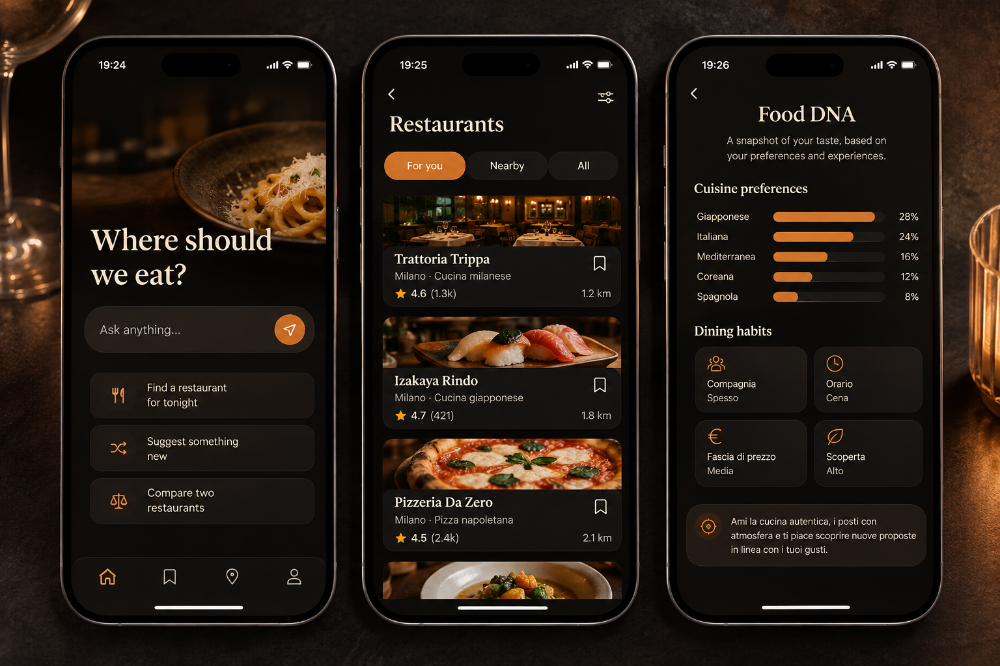
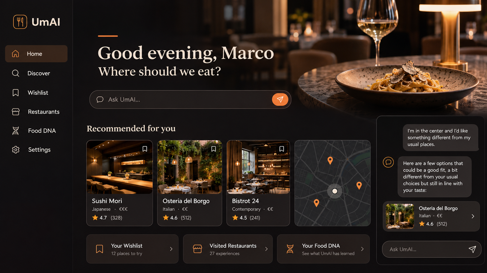

# UmAI

### Your personal food advisor.

UmAI is a personal restaurant advisor that learns what you like, remembers your dining experiences, and helps you decide where to eat next.

## Why UmAI?

Choosing a restaurant is often more complicated than it should be.

You check Google Maps, read reviews, look through saved places, ask friends, and still end up wondering which one is actually right for you.

UmAI takes a different approach.

Instead of treating every user the same, it gradually builds an understanding of **your taste** and uses it when helping you discover restaurants.

## A food advisor that knows you

UmAI learns from the way you interact with food:

- restaurants you want to try
- places you've already visited
- your ratings and experiences
- the things you tend to enjoy
- the things you tend to avoid
- the kind of dining experiences you look for

Over time, these signals become your **Food DNA** — a personal representation of what UmAI has learned about your taste.

## Just ask

The goal is to make choosing a restaurant feel more like talking to someone who knows you well than filling out a search form.

You might ask:

> Where should I eat tonight?

> I want sushi, but something more traditional than last time.

> Which of these two restaurants would I probably prefer?

> Find me something different from what I usually eat.

The more UmAI gets to know you, the more personal the answer can become.

## Personal taste meets the real world

UmAI combines two different kinds of knowledge.

**What the world knows about restaurants** — where they are, what kind of food they serve, what people say about them.

**What you know about restaurants** — where you've been, what you liked, what you didn't, and what you are looking for now.

The interesting part is where these two meet.

## The idea

I started building UmAI around a simple question:

> **What if you could ask an AI where to eat, and it actually knew your taste?**

The long-term goal is to make UmAI feel less like a restaurant search engine and more like **the friend you always ask where to eat**.

Not another list of restaurants.

Not another collection of reviews.

A personal advisor that gets better with every experience.

## Work in progress

UmAI is an independent project I'm building and evolving over time.

The product and its recommendation capabilities are still under active development, and the interface shown above represents the direction I'm exploring rather than a finished product.